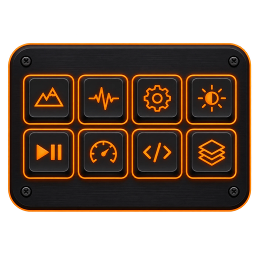
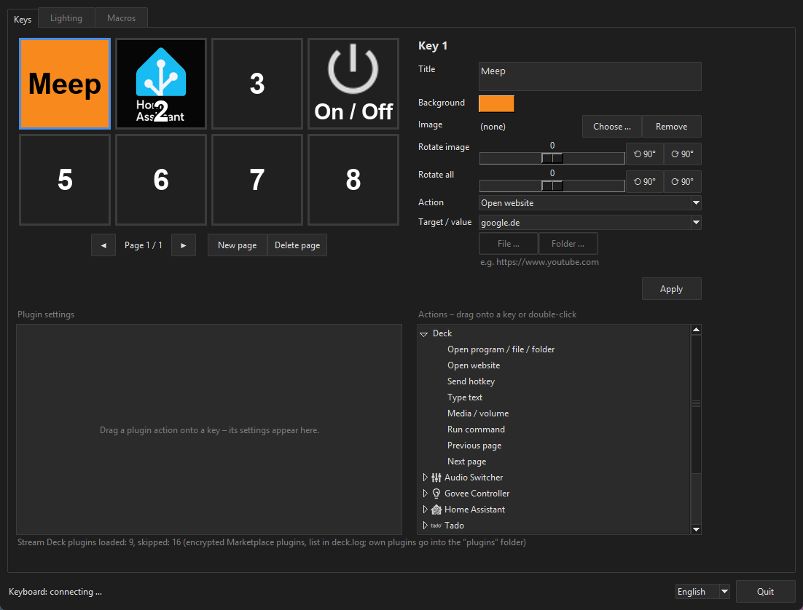
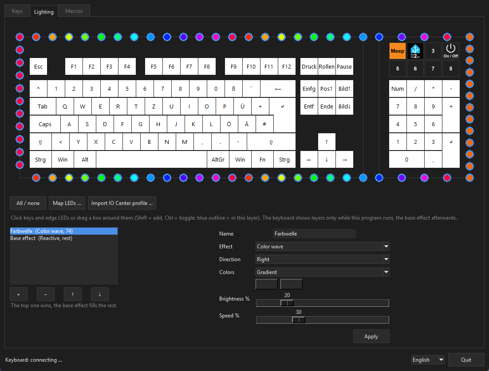

<p align="center"></p>

<p align="center">
  <a href="LICENSE"></a>
  <a href="https://github.com/Moepchi/OnyxIO/actions/workflows/tests.yml"></a>
  
  
  
  <a href="https://github.com/Moepchi/OnyxIO/releases/latest"></a>
  <a href="https://github.com/Moepchi/OnyxIO/releases"></a>
  
</p>

# OnyxIO

*Formerly Dark Mount Deck.* A lean, open replacement for IO Center for the **be quiet! Dark Mount** keyboard on Windows: the eight display keys
work like a Stream Deck, plus lighting and macros. One Python program, no installer, no account, no telemetry.

**[Deutsch weiter unten](#deutsch)**



> Unofficial community project, not affiliated with be quiet! or Elgato. It talks to the keyboard only through the
> same configuration protocol IO Center uses. It never flashes firmware and never touches the bootloader.

## Features

### Display keys
- Title, background color and image per key (PNG, JPG, GIF, …), rotate the image or the whole key.
- Actions: open a program / file / folder, open a website, send a hotkey (`ctrl+shift+m`, `win+d`, `f13`, …),
  type text, media / volume, run a command, previous / next page.
- **Pages** like on a Stream Deck: as many pages of 8 keys as you like; next/previous wrap around.
- Action list grouped by plugin – **drag an action onto a key** or double-click it.

### Stream Deck plugins
- Runs Elgato Stream Deck plugins (SDK 2) on the display keys: plugins installed by the Stream Deck app are found
  automatically, your own go into the `plugins` folder.
- Node.js and HTML plugins (HTML ones run in a hidden Microsoft Edge).
- The plugin's **settings page (Property Inspector) is embedded** right in the window.
- Encrypted Marketplace plugins are skipped on purpose (no DRM circumvention); see `deck.log` for the list.

### Lighting
- Base effect computed by the keyboard itself (keeps running without this program): Static, Color wave, Tornado,
  Breathing, Reactive, Matrix – with direction, one / two colors or gradient, brightness and speed.
- **Layers** on top: pick keys and edge LEDs with a click or a drag box, each layer with its own effect (shown while
  the program runs).
- **OnyxIO-only layer effects** beyond the firmware's: **Ripple** (a colour wave spreads out from every pressed key,
  like a stone in water) and **Custom** – a building-block effect from a motion pattern, a press reaction and a scale,
  or switch on a **free formula** (`sin(t) + d/5`, …) for full control. See the
  [Free formula wiki](https://github.com/Moepchi/OnyxIO/wiki/Free-formula).
- Live preview of the whole keyboard incl. the edge LEDs and the display key images (can be turned off).
- Import an IO Center profile (`.ioprofile`).
- LED mapping wizard for keys that have no LED assigned yet.

### Macros
- Macros are stored **on the keyboard** and work without this program.
- Record keyboard and mouse, edit steps and delays, playback once / while held / repeat.
- Assign a macro to a key or unbind it.

### Media Dock
- Accent color, 12 / 24 h clock, idle screen (clock or your own image), idle and display-off times – stored on the dock.
- While the program runs: the time, **what is playing** (Spotify, browser, … with cover art) and the current page as
  profile; the dock's ◀ ▶ arrows switch pages. The media keys on the dock work without any software.

### Other
- English and German UI (switch bottom right; default follows the Windows display language).
- Closing the window hides it in the **system tray**; the keys keep working. Click the tray icon to open it again,
  right-click → *Quit* (or the **Quit** button) ends the program. Windows 11 may put new tray icons in the ^ overflow.
- Privacy: key presses are evaluated only for the display keys, the Reactive preview (memory only) and while *you*
  record a macro or assign a key. Nothing is logged. OnyxIO makes no network requests of its own; only if you tick
  *Check for updates* it asks GitHub for the latest version number at start.



## Download (no Python needed)
Get **`OnyxIO.exe`** from the [latest release](https://github.com/Moepchi/OnyxIO/releases/latest),
put it in a folder of its own and start it. `deck.json`, `deck.log` and the `plugins` folder are created next to it.
Windows SmartScreen may warn because the file is not signed: *More info → Run anyway*. The exe is built by GitHub
Actions straight from the tagged source – see the **[Code signing policy](https://github.com/Moepchi/OnyxIO/wiki/Code-signing-policy)**.

## Requirements (running from source)
- Windows 10 / 11, be quiet! Dark Mount
- Python 3.10+, Pillow, pystray and the `winrt` packages for the Media Dock (`pip install -r requirements.txt`)
- Optional: Node.js (for Node plugins), Microsoft Edge (for HTML plugins and plugin settings, preinstalled on Windows)

## Start
```bash
pip install -r requirements.txt
pythonw deck.py
```
- **Start with Windows**: tick the box at the bottom right – OnyxIO then starts in the tray when you log in.
  `--min` starts it in the tray by hand.
- **Close IO Center first** – the keyboard accepts only one program at a time.
- Settings are saved in `deck.json` next to the program; plugin output goes to `deck.log`.
- Self-tests: `python deck.py test`, `python darkmount.py test` and `python sdhost.py test` (no keyboard needed).
- Build the .exe yourself: `pip install pyinstaller` then `pyinstaller OnyxIO.spec` (the same as the release
  build; it bundles the Media Dock's now-playing support and sets the version from `deck.py`).

## Files
| File | What |
|---|---|
| `deck.py` | the program (window, display keys, lighting, macros, Media Dock) |
| `sdhost.py` | host for Stream Deck plugins |
| `darkmount.py` | minimal client for the keyboard's protocol |
| `lang.py` | UI texts: English → German |
| `PROTOCOL.md` | protocol notes (German), observed from IO Center's own traffic |

## Adding a language
Copy the `DE` dictionary in `lang.py`, translate the values and add the code to `LANGS` and `tr()`.
Pull requests welcome.

## License
MIT – see [LICENSE](LICENSE). Stream Deck plugins keep their own licenses. "be quiet!", "Dark Mount", "Elgato" and
"Stream Deck" are trademarks of their owners.

---

<a id="deutsch"></a>
# OnyxIO (Deutsch)

*Früher Dark Mount Deck.* Ein schlanker, offener Ersatz für IO Center für die **be quiet! Dark Mount** unter Windows: Die acht Displaytasten
funktionieren wie ein Stream Deck, dazu Beleuchtung und Makros. Ein Python-Programm, kein Installer, kein Konto,
keine Telemetrie.

> Inoffizielles Community-Projekt, nicht verbunden mit be quiet! oder Elgato. Es spricht mit der Tastatur nur über
> dasselbe Konfigurationsprotokoll wie IO Center. Es flasht nie Firmware und rührt den Bootloader nicht an.

## Funktionen

### Displaytasten
- Titel, Hintergrundfarbe und Bild pro Taste, Bild oder ganze Taste drehen.
- Aktionen: Programm / Datei / Ordner öffnen, Website öffnen, Tastenkürzel senden, Text eingeben,
  Medien / Lautstärke, Befehl ausführen, vorherige / nächste Seite.
- **Seiten** wie beim Stream Deck: beliebig viele Seiten mit 8 Tasten; vor/zurück läuft im Kreis.
- Aktionsliste nach Plugin gruppiert – **Aktion auf eine Taste ziehen** oder doppelklicken.

### Stream-Deck-Plugins
- Führt Elgato-Stream-Deck-Plugins (SDK 2) auf den Displaytasten aus: Plugins der Stream-Deck-App werden automatisch
  gefunden, eigene kommen in den Ordner `plugins`.
- Node.js- und HTML-Plugins (HTML-Plugins laufen in einem unsichtbaren Microsoft Edge).
- Die **Plugin-Einstellungen (Property Inspector) sind direkt ins Fenster eingebettet**.
- Verschlüsselte Marketplace-Plugins werden bewusst übersprungen (keine DRM-Umgehung); Liste in `deck.log`.

### Beleuchtung
- Grundeffekt, den die Tastatur selbst rechnet (läuft auch ohne dieses Programm): Statisch, Farbwelle, Tornado,
  Atmen, Reaktiv, Matrix – mit Richtung, ein / zwei Farben oder Verlauf, Helligkeit und Tempo.
- **Ebenen** darüber: Tasten und Rand-LEDs anklicken oder einrahmen, jede Ebene mit eigenem Effekt (sichtbar, solange
  das Programm läuft).
- **Nur-OnyxIO-Ebeneneffekte** über die der Firmware hinaus: **Wassertropfen** (eine Farbwelle breitet sich von jeder
  gedrückten Taste aus, wie ein Stein im Wasser) und **Baukasten** – ein Effekt aus Muster, Druckreaktion und Skala,
  oder per **freier Formel** (`sin(t) + d/5`, …) komplett selbst gebaut. Siehe das
  [Wiki zur freien Formel](https://github.com/Moepchi/OnyxIO/wiki/Free-formula).
- Live-Vorschau der ganzen Tastatur inkl. Rand-LEDs und Displaytasten-Bildern (abschaltbar).
- IO-Center-Profil (`.ioprofile`) importieren.
- Assistent zum Zuordnen der LEDs.

### Makros
- Makros liegen **auf der Tastatur** und funktionieren ohne dieses Programm.
- Tastatur und Maus aufnehmen, Schritte und Pausen bearbeiten, abspielen einmal / solange gedrückt / wiederholen.
- Makro einer Taste zuweisen oder lösen.

### Media Dock
- Menüfarbe, Uhr 12 / 24 h, Leerlaufgrafik (Uhr oder eigenes Bild), Zeiten für Leerlauf und Display aus – liegen auf
  dem Dock.
- Solange das Programm läuft: Uhrzeit, **was gerade läuft** (Spotify, Browser, … mit Cover) und die aktuelle Seite als
  Profil; die Pfeile ◀ ▶ am Dock blättern die Seiten. Die Medientasten am Dock gehen auch ohne Software.

### Sonstiges
- Oberfläche auf Englisch und Deutsch (unten rechts umschalten; Standard folgt der Windows-Anzeigesprache).
- Fenster schließen legt es in den **Infobereich (Tray)**; die Tasten funktionieren weiter. Klick aufs Tray-Icon
  öffnet es wieder, Rechtsklick → *Beenden* (oder der Knopf **Beenden**) beendet das Programm. Windows 11 legt neue
  Tray-Icons eventuell unter ^ ab.
- Datenschutz: Tastendrücke werden nur für die Displaytasten, die Reaktiv-Vorschau (nur im Speicher) und während
  *du* ein Makro aufnimmst oder eine Taste zuweist ausgewertet. Nichts wird protokolliert. OnyxIO stellt von sich aus
  keine Netzwerkanfragen; nur wenn du *Nach Updates suchen* anhakst, fragt es beim Start GitHub nach der neuesten
  Versionsnummer.

## Download (ohne Python)
**`OnyxIO.exe`** aus dem [neuesten Release](https://github.com/Moepchi/OnyxIO/releases/latest) laden,
in einen eigenen Ordner legen und starten. `deck.json`, `deck.log` und der Ordner `plugins` entstehen daneben.
Windows SmartScreen kann warnen, weil die Datei nicht signiert ist: *Weitere Informationen → Trotzdem ausführen*. Die
exe baut GitHub Actions direkt aus dem getaggten Quellcode – siehe die **[Code signing policy](https://github.com/Moepchi/OnyxIO/wiki/Code-signing-policy#richtlinie-zur-code-signatur-deutsch)**.

## Voraussetzungen (aus dem Quellcode)
- Windows 10 / 11, be quiet! Dark Mount
- Python 3.10+, Pillow, pystray und die `winrt`-Pakete fürs Media Dock (`pip install -r requirements.txt`)
- Optional: Node.js (für Node-Plugins), Microsoft Edge (für HTML-Plugins und Plugin-Einstellungen, bei Windows dabei)

## Starten
```bash
pip install -r requirements.txt
pythonw deck.py
```
- **Mit Windows starten**: Haken unten rechts setzen – OnyxIO startet dann bei der Anmeldung im Tray.
  `--min` startet es von Hand im Tray.
- **Vorher IO Center schließen** – die Tastatur nimmt nur ein Programm gleichzeitig an.
- Einstellungen landen in `deck.json` neben dem Programm, Plugin-Ausgaben in `deck.log`.
- Selbsttests: `python deck.py test`, `python darkmount.py test` und `python sdhost.py test` (ohne Tastatur).
- .exe selbst bauen: `pip install pyinstaller`, dann `pyinstaller OnyxIO.spec` (wie der Release-Build;
  bündelt die Now-Playing-Unterstützung fürs Media Dock und setzt die Version aus `deck.py`).

## Lizenz
MIT – siehe [LICENSE](LICENSE). Stream-Deck-Plugins behalten ihre eigenen Lizenzen. „be quiet!“, „Dark Mount“,
„Elgato“ und „Stream Deck“ sind Marken ihrer jeweiligen Inhaber.
